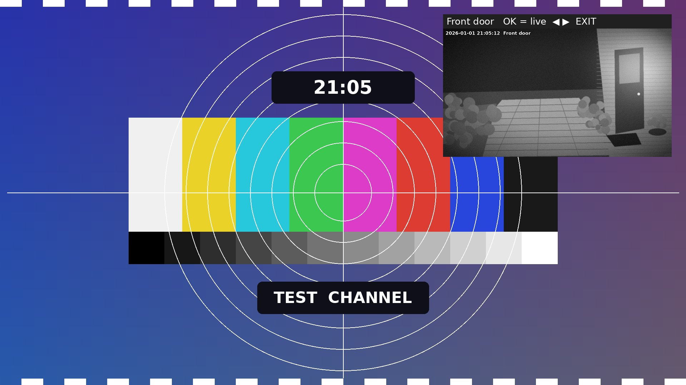
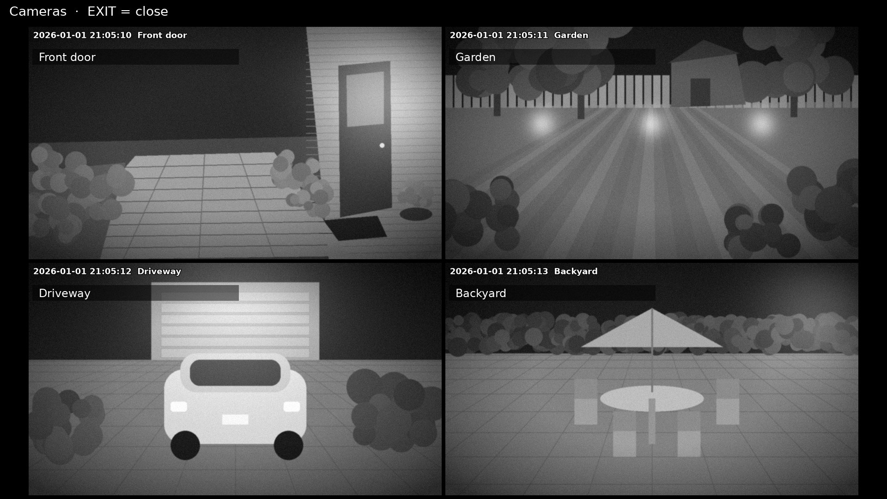
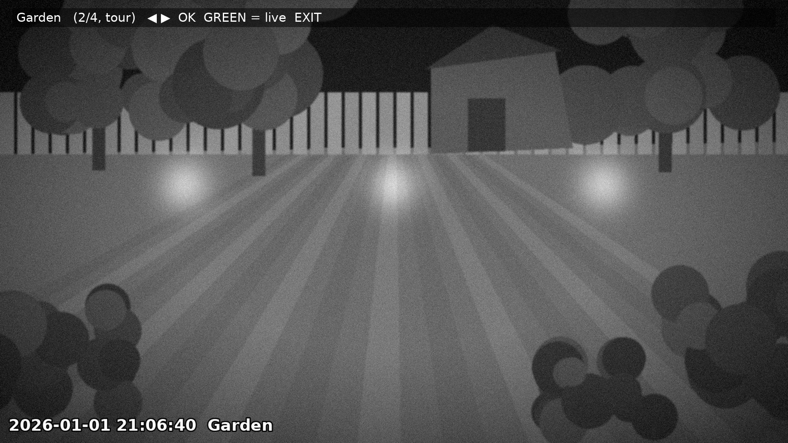

# CamAlert for Enigma2 and Kodi

**CamAlert** shows your IP cameras on the TV of an Enigma2 receiver (openATV, OpenPLi, VTi, ... on VU+, Dreambox, Zgemma, Octagon and others) or a **Kodi** media player (LibreELEC, CoreELEC, OSMC, Windows, Linux, Android; Kodi 20 or newer) – with the same Home Assistant integration, blueprints, MQTT topics and HTTP API for both.



When someone rings the doorbell, walks up to the door, or the alarm goes off, your home automation (for example Home Assistant) asks the receiver to show that camera:

- **Photo window** – a small window in a corner of the screen with a fresh picture every 1–2 seconds; you keep watching TV.
- **Live** – the receiver switches to the live camera stream and back to your channel when the time is up.
- **Notification** – just a message on screen.

It also creates a **channel list with all your cameras**, so you can zap to them like normal channels.

CamAlert works with any camera that has an RTSP stream (UniFi Protect, Reolink, Hikvision, Dahua/Amcrest, TP-Link Tapo, Axis, ...), preferably through **[go2rtc](https://github.com/AlexxIT/go2rtc)**, a small free camera streaming server. It can also [connect to the cameras directly](docs/without-go2rtc.md).

> 📖 **New here? Follow the [step-by-step guide](docs/guide.md).** No programming needed.

## How it fits together


## Features

- Settings screen on the receiver, in English, Dutch, German, French, Italian and Polish.
- Cameras are read from go2rtc automatically – choose them with the remote.
- Photo window: position (4 corners) and size (small / medium / large).
- Live mode with automatic return to the previous channel.
- Camera channel list ("bouquet") that keeps itself up to date, with your own camera names.
- Mosaic: up to 9 cameras at once (photo mosaic, or a live mosaic channel via go2rtc).
- **Home Assistant integration** (UI only, no YAML) with ready-made blueprints: doorbell, motion when armed / at set times, alarm.
- **MQTT** with Home Assistant discovery, and an HTTP API for Node-RED, openHAB, scripts, ...
- Priorities: *normal* follows the receiver's rules, *high* (doorbell) always comes through, *alarm* can wake the receiver.
- Camera tour (one camera after the other, hold with OK) and a remote-controlled photo window (OK = live, ◀ ▶ = other camera).
- Only reacts when the receiver is on (not in standby) and you are not already watching that camera.
- Local network only by default, optional access token.

## Screenshots

*Illustrations: the camera pictures and the TV test picture are drawn, not real footage.*

| Mosaic – up to 9 cameras at once | Camera tour – one after the other |
|---|---|
|  |  |

## Install

### Home Assistant integration
Marketplace (HACS) › Custom repositories › `https://github.com/kevinrossnl/camalert` (Integration), see [docs/home-assistant.md](docs/home-assistant.md).

### Receiver plugin

On the receiver (via Telnet/SSH), replace the version with the [latest release](../../releases/latest):

```sh
cd /tmp
wget -O camalert.ipk https://github.com/kevinrossnl/camalert/releases/download/v1.0.0/enigma2-plugin-extensions-camalert_1.0.0_all.ipk
opkg install /tmp/camalert.ipk
```

Then restart the GUI and open **Menu › Plugins › CamAlert**.

### Kodi add-on

Download `repository.camalert-*.zip` from the [latest release](../../releases/latest) and in Kodi choose **Add-ons › Install from zip file**, then **Install from repository › CamAlert repository › Services › CamAlert**. Kodi then keeps CamAlert up to date by itself. See [docs/kodi.md](docs/kodi.md).

## Documentation

| | |
|---|---|
| [Step-by-step guide](docs/guide.md) | From nothing to a camera pop-up on your TV |
| [go2rtc as Home Assistant app](docs/go2rtc-home-assistant.md) | Easiest if you already run Home Assistant OS |
| [go2rtc in Docker / TrueNAS / Synology](docs/go2rtc-docker.md) | Run go2rtc as its own container |
| [Camera stream addresses](docs/cameras.md) | RTSP URLs for popular camera brands |
| [Without go2rtc](docs/without-go2rtc.md) | Connect the receiver directly to the cameras |
| [Home Assistant](docs/home-assistant.md) | Integration, blueprints, MQTT, priorities |
| [Several cameras at once](docs/mosaic.md) | Photo mosaic or live mosaic channel |
| [Kodi](docs/kodi.md) | The Kodi add-on: install, settings, remote control, differences |
| [HTTP API](docs/api.md) | For other systems and scripts |
| [Troubleshooting](docs/troubleshooting.md) | Black picture, slow start, no pop-up, ... |
| [Translating](docs/translating.md) | Add or improve a language |

## Why go2rtc?

Enigma2 receivers can play RTSP, but connecting directly to every camera is slow and many cameras only allow a few connections. go2rtc keeps one connection per camera, can keep your doorbell camera "warm" so it starts quickly, and makes snapshots for the photo window. It is free, small and runs almost anywhere.

## Limitations

- Hardware picture-in-picture on Enigma2 only plays TV channels, not network streams. That is why CamAlert uses a photo window instead of a real PiP.
- After switching to a camera it takes until the next key frame (usually 1–2 seconds) before the picture appears.

## License

GPL-2.0-only, see [LICENSE](LICENSE). Not affiliated with any camera brand.
