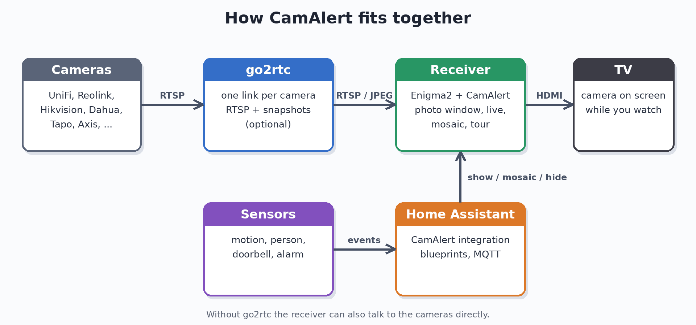
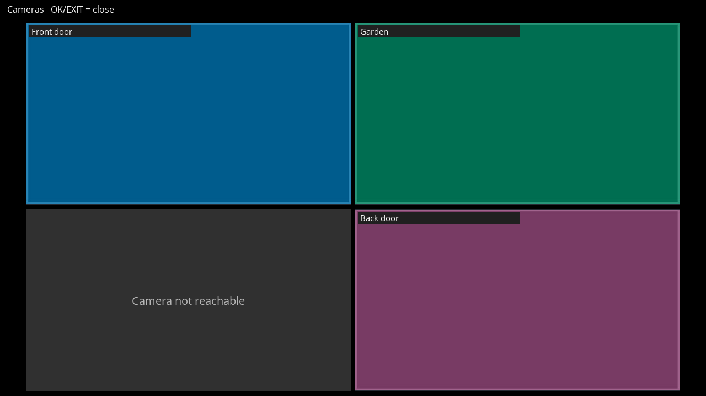
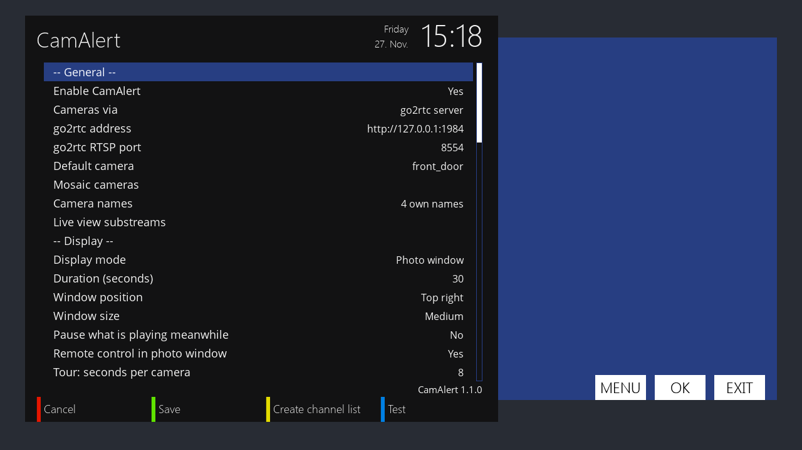
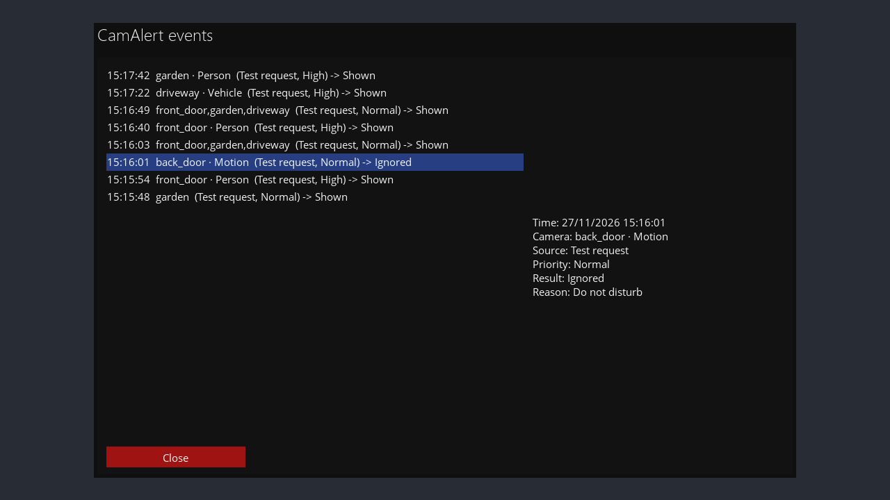

# CamAlert for Enigma2 and Kodi

**CamAlert** shows your IP cameras on the TV: on an **Enigma2 receiver** (openATV, OpenPLi, VTi, ... on VU+,
Dreambox, Zgemma, Octagon and others) or a **Kodi** player (LibreELEC, CoreELEC, OSMC, Windows, Linux, Android;
**Kodi 19 or newer**). Both players have the same Home Assistant integration, blueprints, MQTT topics and HTTP API.

When someone rings the doorbell, walks up to the door, or the alarm goes off, your home automation (for example Home
Assistant) asks the player to show that camera:

- **Photo window** – a small window in a corner of the screen with a fresh picture every 1–2 seconds; you keep
  watching TV.
- **Multi-camera window** – 2 to 4 cameras together in one window.
- **Live view** – the camera full screen; afterwards the player goes back to your channel or film.
- **Notification** – a small message with one picture.

There is also a **mosaic** (up to 9 cameras), a **tour** (one camera after the other) and, on Enigma2, a **channel
list with all your cameras**.

CamAlert works with any camera that has an RTSP stream (UniFi Protect, Reolink, Hikvision, Dahua/Amcrest, TP-Link
Tapo, Axis, ...), preferably through **[go2rtc](https://github.com/AlexxIT/go2rtc)**, a small free camera streaming
server. It can also [connect to the cameras directly](docs/user/without-go2rtc.md).

> **New here? Follow the [step-by-step guide](docs/user/guide.md).** No programming needed.

## How it fits together

## Features

- Settings on the player, in English, Dutch, German, French, Italian and Polish.
- Cameras are read from go2rtc automatically – choose them with the remote.
- Photo window: position (4 corners) and size (small / medium / large); OK = live view, ◀ ▶ = other camera.
- Priorities: *normal* follows the player's rules, *high* (doorbell) always comes through, *alarm* can wake the
  player.
- Do not disturb, active hours, cooldown per camera, not while a recording or film plays.
- **Home Assistant integration** (UI only, no YAML) with ready-made blueprints: doorbell, motion when armed / at set
  times, alarm, remote button.
- **MQTT** with Home Assistant discovery, **Frigate** events without Home Assistant, and an HTTP API for Node-RED,
  openHAB, scripts, ...
- Colour keys of the remote to Home Assistant (open the gate with GREEN), camera control (PTZ) for ONVIF and Foscam.
- Event list and diagnostics on the TV, Prometheus metrics and a Grafana dashboard.
- Local network only by default, optional access token.

## Screenshots

*The camera pictures are solid test colours (demo cameras) or drawn: no real footage, no TV programme.*

| Photo window | Mosaic – one camera not reachable |
|---|---|
|  |  |
| **Settings on an Enigma2 receiver** | **Event list** |
|  |  |

More: [Enigma2 receiver](docs/players/enigma2.md), [illustrated mosaic](docs/images/mosaic.jpg) and
[tour](docs/images/tour.jpg).

## Install

| | |
|---|---|
| **Enigma2 receiver** | `.ipk` from the [latest release](https://github.com/kevinrossnl/camalert/releases/latest) or the opkg feed: [Enigma2 receiver](docs/players/enigma2.md#install) |
| **Kodi** | the CamAlert repository zip, Kodi then updates CamAlert by itself: [Kodi](docs/players/kodi.md#install) |
| **Home Assistant** | Marketplace (HACS) › Custom repositories › `https://github.com/kevinrossnl/camalert` (Integration): [Home Assistant](docs/integrations/home-assistant.md) |

## Documentation

All pages: **[docs/index.md](docs/index.md)**. Most used:

| | |
|---|---|
| [Step-by-step guide](docs/user/guide.md) | From nothing to a camera in the photo window on your TV |
| [go2rtc](docs/user/go2rtc-home-assistant.md) | As Home Assistant app, or [in Docker / TrueNAS / Synology](docs/user/go2rtc-docker.md) |
| [Enigma2 receiver](docs/players/enigma2.md) / [Kodi](docs/players/kodi.md) | Install, settings, what is different |
| [Home Assistant](docs/integrations/home-assistant.md) | Integration, actions, blueprints |
| [Remote keys](docs/user/keys.md) | Which key does what, on both players |
| [Troubleshooting](docs/user/troubleshooting.md) | Black picture, slow start, nothing appears, ... |

## Why go2rtc?

Enigma2 receivers can play RTSP, but connecting directly to every camera is slow and many cameras only allow a few
connections. go2rtc keeps one connection per camera, can keep your doorbell camera "warm" so it starts quickly, and
makes the snapshots for the photo window. It is free, small and runs almost anywhere.

## Limitations

- Hardware picture-in-picture on Enigma2 only plays TV channels, not network streams. That is why CamAlert uses a
  photo window instead of a real PiP.
- After switching to live view it takes until the next key frame (usually 1–2 seconds) before the picture appears.

## License

GPL-2.0-only, see [LICENSE](LICENSE). Not affiliated with any camera brand. Contributing: [developer docs](docs/index.md#developers).
