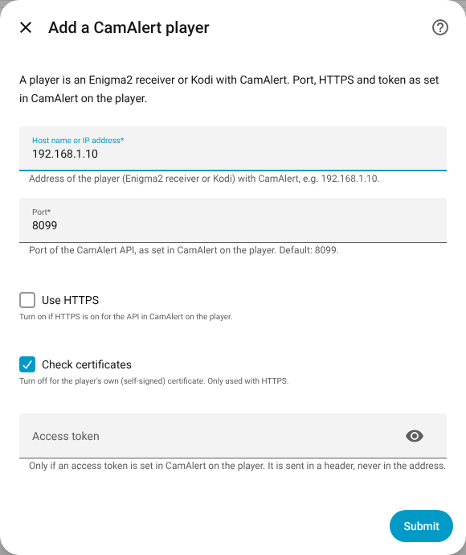
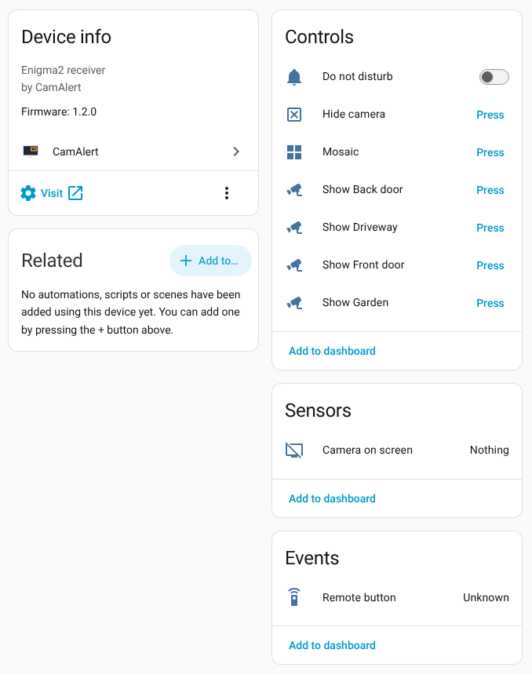
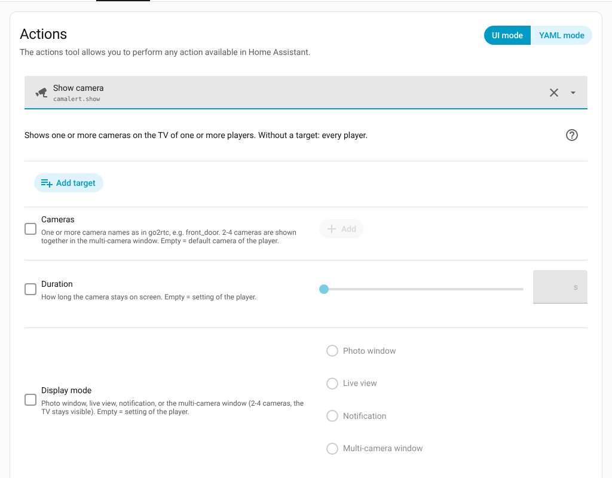
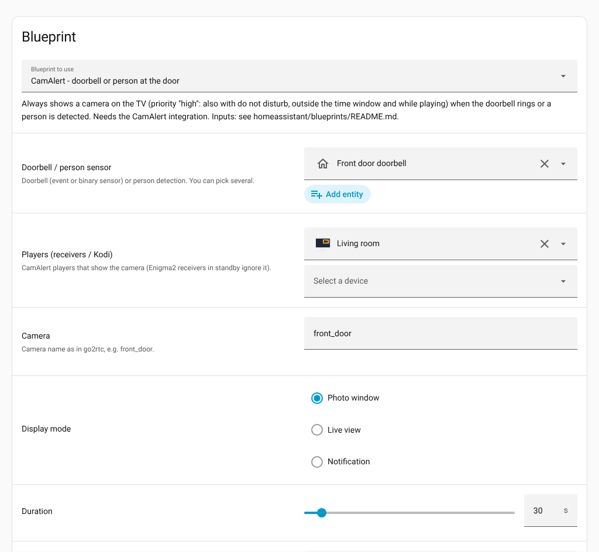

# Home Assistant

There are three ways to connect CamAlert to Home Assistant. **The integration is recommended**: everything is done in
the user interface, no YAML. It works the same for Enigma2 receivers, Kodi and the Android TV / Fire TV app: all are a CamAlert **player**.

| | Integration (recommended) | [MQTT](mqtt.md) | REST command |
|---|---|---|---|
| Set up via the UI only | yes | yes | no (YAML) |
| Needs | nothing extra | an MQTT broker | nothing extra |
| Works with the blueprints below | yes | no | no |

## 1. Integration

### Install

1. Open **Settings › Marketplace** (in older versions: HACS), search for **CamAlert**, install it and restart
   Home Assistant. CamAlert is in the HACS default list, so no extra repository is needed.
2. Only if CamAlert does not show up (for example an older HACS): menu **⋮ › Custom repositories**, add
   `https://github.com/kevinrossnl/camalert` with type **Integration**, then search again.
3. Without HACS: download `camalert-homeassistant-x.y.z.zip` from the
   [latest release](https://github.com/kevinrossnl/camalert/releases/latest) and unpack it into your Home Assistant
   `config` folder (it contains `custom_components/camalert/`), then restart.
4. **Found automatically:** a player with CamAlert 1.3 or later announces itself on the local network. Home
   Assistant shows it under **Settings › Devices & services › Discovered**: click **Add** and confirm. Only when an
   access token is set on the player does Home Assistant ask for it. When the player later gets another IP address,
   Home Assistant takes it over by itself.
5. **By hand** (an older player, or a network that blocks multicast, such as a separate VLAN without an mDNS
   repeater): **Settings › Devices & services › Add integration › CamAlert**. Enter the host name or IP address of
   the player (and the port, HTTPS and token if you changed them in CamAlert). Repeat for every player.
   *Reconfigure* on the entry changes the address, port, HTTPS or token later.
6. **A new player is set up from Home Assistant:** when the player has no go2rtc address yet, Home Assistant offers
   to send one right after adding it. The address is filled in when Home Assistant knows a go2rtc the player can
   reach (the go2rtc integration with an address, or the go2rtc app); you can change it, add a default camera, or
   leave it empty to skip. The player shows *Settings received from Home Assistant* and uses the address at once.
   Later, **Configure** on the entry (*Send go2rtc address*) sends another address; a player that is set up only
   accepts an address in your local network. The built-in go2rtc of Home Assistant only listens on Home Assistant
   itself, so it is not offered.
7. The player's device is shown under the device of the TV or Enigma2 receiver it runs on: automatically when the
   Enigma2, Kodi or Android TV integration has a device with the same address. **Configure** on the entry
   (*Show under device*) chooses another device, or none.

The device model shows *Enigma2 receiver* or *Kodi*. Certificates are checked by default; turn *Check certificates*
off only for the player's own self-signed certificate. A discovered player with HTTPS on is added with the check off
(it uses its own certificate); *Reconfigure* turns it on.

**What a player announces** (DNS-SD service `_camalert._tcp`, port of the API): its name and the keys `id`, `name`,
`platform`, `version`, `api_version` and `https`. Never a token or another setting. Nothing is announced while
*Enable CamAlert* is off. On an Enigma2 receiver avahi does it (a file in `/etc/avahi/services/`, removed with the
plugin); on Kodi (LibreELEC, desktop) and wherever avahi cannot be used, CamAlert answers the network queries itself;
the Android TV app uses Android's network service discovery.

### What you get per player

- A **button per camera** ("Show Front door"), a **Mosaic** button and **Hide camera** (only what the player supports).
- A sensor **Camera on screen** (*Nothing* when no camera is shown).
- A switch **Do not disturb** (blocks normal requests; doorbell and alarm still come through, configurable on the
  player).
- An event entity **Remote button**: while a camera is on screen, the colour keys of the remote fire an event
  (`red`, `green`, `yellow`, `blue`, with the camera as attribute). The integration also fires the bus event
  `camalert_button` (`device_id`, `player`, `camera`, `button`; `receiver` is kept for older automations). Use the
  blueprint *CamAlert - remote button does something* to, for example, open the gate with GREEN when the doorbell
  camera shows who is there ([remote keys](../user/keys.md#colour-keys-to-home-assistant)).
- A notify entity **Notification**: the action `notify.send_message` shows the message (at most 40 characters) as
  a notification on the TV, with the picture of a camera. A *title* that is the name of a camera picks that camera;
  any other title goes before the message, and the player's default camera is shown.
- An update entity **CamAlert**: the CamAlert version on the player against the
  [latest release](https://github.com/kevinrossnl/camalert/releases/latest), with the release notes. Home Assistant
  checks GitHub at most once every 6 hours for all players (no account or token). It only tells you there is an
  update: install it on the player as before.
- Two selects **Window position** and **Window size** (under *Configuration*): where the photo window appears and
  how big it is, the same settings as on the player. A change is saved on the player and used by the next window,
  so an automation can, for example, make the window small in the evening or large for the doorbell. Only players
  from CamAlert 1.3 on have them.
- **Download diagnostics** on the integration entry: version, platform, capabilities, status, last events and the
  player's log (redacted).
- Actions for automations and scripts:

| Action | Fields |
|---|---|
| `camalert.show` | players (target), cameras (one or more: 2–4 are shown together in one multi-camera window), seconds (0 = until `camalert.hide`, at most 10 minutes; older players get 300 s), mode (photo / live / notify / strip), priority (normal / high / alarm), label (who/what, e.g. Person) |
| `camalert.ptz` | players, camera, move (up / down / left / right / zoom_in / zoom_out / home / stop) |
| `camalert.mosaic` | players, cameras (list), seconds |
| `camalert.hide` | players |

Target (*players*): one or more CamAlert players (devices), their entities or their areas; no target = every
player. Existing automations with `target: device_id:` keep working.

An action that fails (player not reachable, unknown camera, not supported) raises a translated error in the
automation trace; with several players all are tried first.

### Priority

What `normal`, `high` and `alarm` do on the player: [features › priorities](../user/features.md#priorities).

### Doorbell without an automation

Open the player in **Settings › Devices & services › CamAlert**, press **Configure** and pick your doorbell under
**Doorbell**: an event entity (for example `event.front_door_doorbell` of UniFi Protect, Reolink or Ring) or a binary
sensor that turns on when someone rings. Optionally fill in **Doorbell camera** (the go2rtc name, e.g. `front_door`;
empty = the player's default camera). From then on every ring shows that camera on this player with priority high
and the label *Doorbell*, without an automation (#90).

- An event entity counts when its event type is a ring (`ring`, `doorbell`, `press`, `pressed`, `single`, ...) or
  when the entity is a doorbell (device class `doorbell`); a binary sensor counts when it turns from off to on.
- After a restart of Home Assistant, or when the doorbell comes back from unavailable, nothing is shown.
- Two rings within 15 seconds give one window (a press and a release, or two entities of one doorbell).
- Want more (several players, presence, a phone, other screens)? Use the doorbell blueprint below instead, or
  as well: the 15 seconds keep it to one window per player.

### Notifications on your phone

Phones are covered by the [Home Assistant Companion app](https://companion.home-assistant.io/): the doorbell,
motion and alarm blueprints have **Also notify phones** (#14, #128). Fill in the notify actions of your phones,
comma-separated, e.g. `mobile_app_my_phone, mobile_app_other_phone`. Each phone gets:

- the camera picture when you fill in **Camera entity for the phone** (`camera.front_door`); tapping the
  notification opens that camera;
- with **Buttons on the phone notification** (on by default): **Show on TV** (shows the camera on the blueprint's
  players, priority high) and **Do not disturb 1 h** (turns Do not disturb on for those players and off again after
  an hour; a restart of Home Assistant in that hour leaves it on). The CamAlert integration handles both buttons;
  no extra automation is needed;
- with **Critical phone notification** (on by default for the alarm): the notification comes through the phone's
  silent mode and Do not disturb (iOS critical alert, Android alarm channel);
- one notification per camera: a new one replaces the previous one instead of piling up.

The phone notification follows the blueprint's own conditions (for motion: armed and/or the time window), but not
*Only when someone is home*: the phone also gets it when nobody is home. The picture outside your home needs
remote access to Home Assistant (Nabu Casa or your own address).

### Ready-made blueprints

Import them via **Settings › Automations & scenes › Blueprints › Import blueprint** and paste the address:

| Blueprint | What it does |
|---|---|
| [Doorbell or person](../../homeassistant/blueprints/camalert_doorbell.yaml) `https://github.com/kevinrossnl/camalert/blob/main/homeassistant/blueprints/camalert_doorbell.yaml` | Always shows the door camera (priority high) |
| [Motion when armed or at set times](../../homeassistant/blueprints/camalert_motion.yaml) `https://github.com/kevinrossnl/camalert/blob/main/homeassistant/blueprints/camalert_motion.yaml` | Motion → camera(s), only when the alarm is armed and/or between two times. Leave *Cameras* empty to show the camera named after the sensor (`binary_sensor.garden_motion` → `garden`) |
| [Alarm triggered](../../homeassistant/blueprints/camalert_alarm.yaml) `https://github.com/kevinrossnl/camalert/blob/main/homeassistant/blueprints/camalert_alarm.yaml` | Wakes the players and shows a camera or live mosaic (priority alarm) |
| [Doorbell on the players and an LG TV](../../homeassistant/blueprints/camalert_doorbell_webos.yaml) `https://github.com/kevinrossnl/camalert/blob/main/homeassistant/blueprints/camalert_doorbell_webos.yaml` | As *Doorbell or person*, plus a notification with a snapshot on an LG webOS TV (LG webOS TV integration); use *Snapshot URL* for a small picture, the TV refuses pictures over 100 KB; optional live view in the TV's browser ([details](../user/recipes.md)) |
| [Doorbell on the players and other screens](../../homeassistant/blueprints/camalert_doorbell_screens.yaml) `https://github.com/kevinrossnl/camalert/blob/main/homeassistant/blueprints/camalert_doorbell_screens.yaml` | As *Doorbell or person*, plus live view on a Chromecast / Google TV and a notification on an Android TV / Fire TV, for TVs without CamAlert ([details](../user/recipes.md#other-screens)) |
| [Remote button does something](../../homeassistant/blueprints/camalert_button.yaml) `https://github.com/kevinrossnl/camalert/blob/main/homeassistant/blueprints/camalert_button.yaml` | A colour key on the remote runs an action while a camera is on screen |

Then press **Create automation** on a blueprint and fill in the fields. Every input, its default and the rules for
changing them (frozen for 1.x): [blueprint inputs](../../homeassistant/blueprints/README.md).

**UniFi Protect users:** motion and person sensors only work when detection is enabled for that camera
(`switch.<camera>_detections_motion`).

## 2. MQTT (no integration needed)

See [MQTT](mqtt.md).

## 3. REST command (YAML)

For setups without the integration or MQTT: copy
[`homeassistant/camalert_package.yaml`](../../homeassistant/camalert_package.yaml) to
`<config>/packages/camalert.yaml` (with `homeassistant: packages: !include_dir_named packages` in
`configuration.yaml`) and restart. Then use `rest_command.camalert_show` with `host`, `cam`, `sec`, `mode`, `token`.
