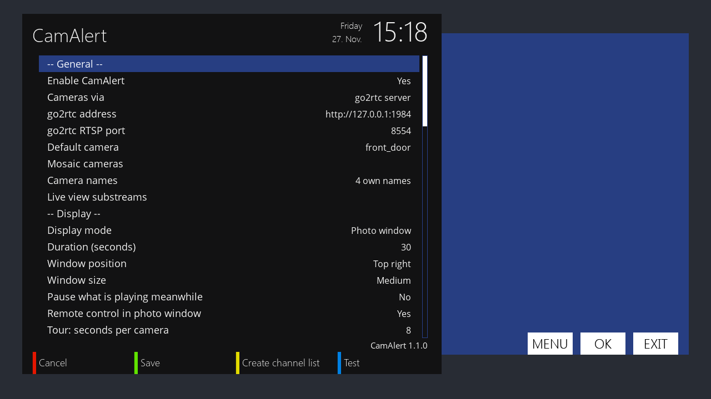
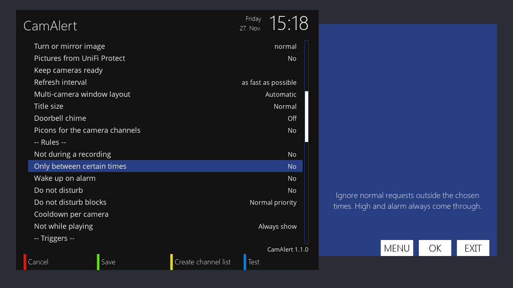
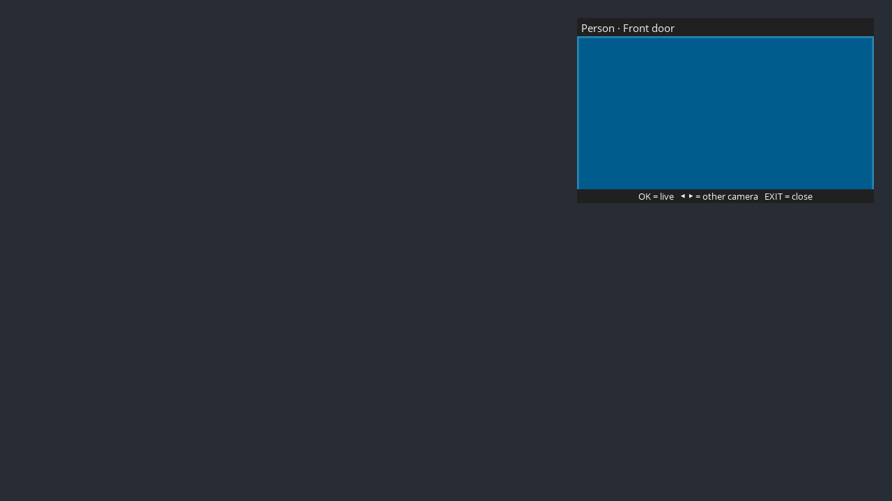
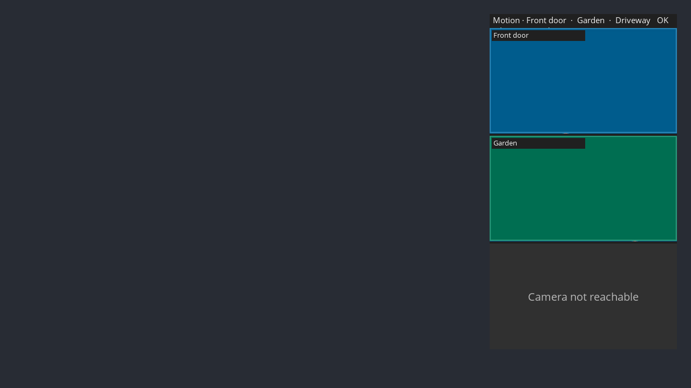
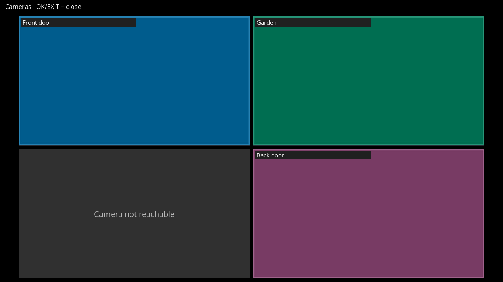
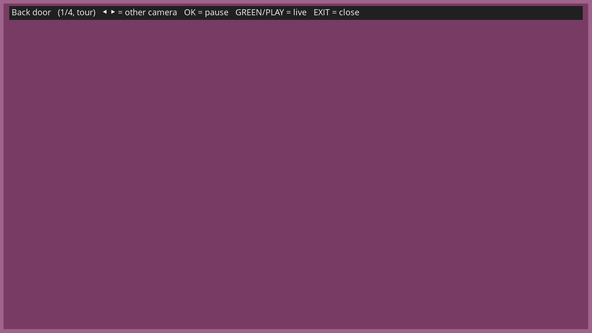
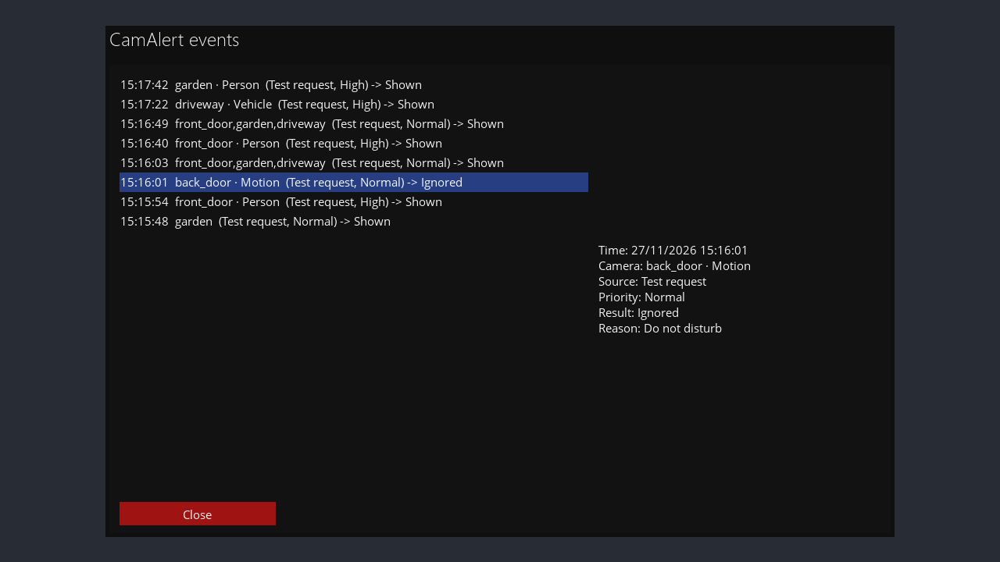
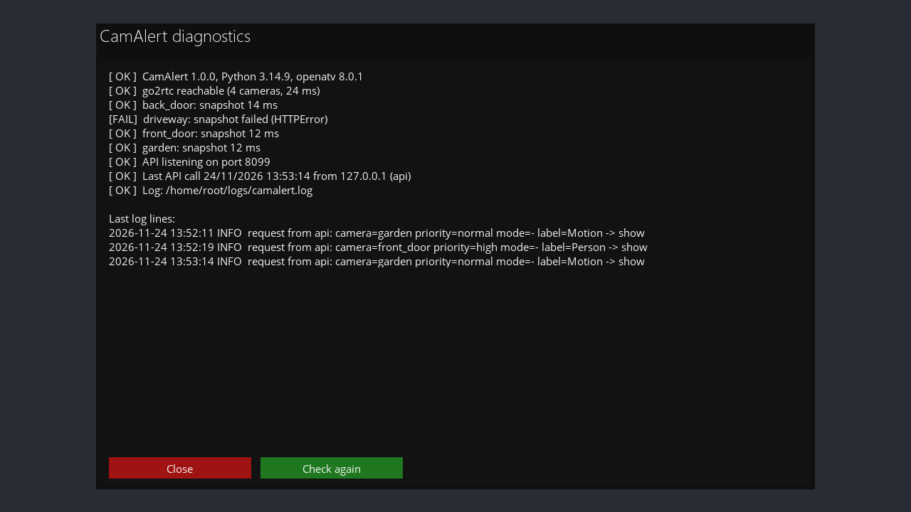
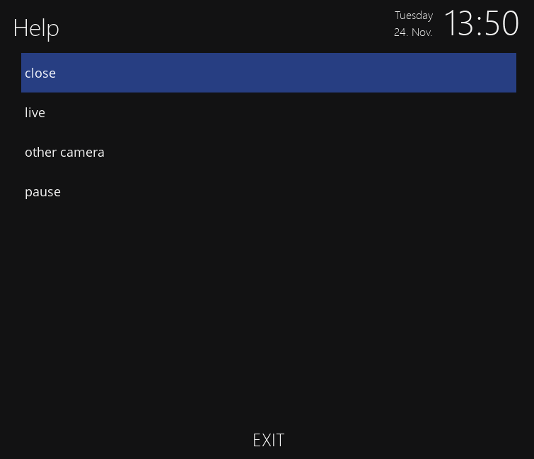

# CamAlert on an Enigma2 receiver

The Enigma2 plugin (`enigma2-plugin-extensions-camalert`) runs on receivers with Python 3: openATV 7 or newer,
OpenPLi 9 or newer, OpenBH, VTi, ... (details: [compatibility](../dev/compatibility.md)). DreamOS (Python 2.7) is
not supported.

## Install

On the receiver (via Telnet/SSH), add the CamAlert opkg feed and install from it. The receiver's normal software
update then keeps CamAlert up to date:

```sh
wget -O /etc/opkg/camalert-feed.conf https://kevinrossnl.github.io/camalert/camalert-feed.conf
opkg update && opkg install enigma2-plugin-extensions-camalert
```

or create `/etc/opkg/camalert-feed.conf` yourself with the line `src/gz camalert https://kevinrossnl.github.io/camalert`.
Then restart the GUI and open **Menu › Plugins › CamAlert**.

**Already installed from an `.ipk` file?** Add the feed with the two commands above: `opkg install` then upgrades
CamAlert and keeps your settings. Without the feed the software update never updates CamAlert.

**Without the feed** (for example a receiver without internet access): download the `.ipk` of the
[latest release](https://github.com/kevinrossnl/camalert/releases/latest) and install it; it does not update by itself.

```sh
cd /tmp
wget -O camalert.ipk https://github.com/kevinrossnl/camalert/releases/download/v1.1.0/enigma2-plugin-extensions-camalert_1.1.0_all.ipk
opkg install /tmp/camalert.ipk
```

### Updates

With the feed, every release arrives through the receiver's software update.
*Check for updates* (on by default) also looks once a day on GitHub for a newer release and shows a message once per
version.

The feed only holds the **latest** release. To go back to an older version, download its `.ipk` from the
[releases page](https://github.com/kevinrossnl/camalert/releases) and install it as above.

## Settings

**Menu › Plugins › CamAlert**. The screen uses your skin's own settings layout, with a help text for the selected
row and section headings: General, Display, Rules, Triggers, Camera control, Home Assistant / MQTT, API, Channel list,
Log. Which rows you see follows *Menu › Setup › System › Settings level* (simple / intermediate / expert); MENU ›
*Show all settings* shows everything. Every setting is listed in [settings](../user/settings.md).




| Key | In the settings |
|---|---|
| GREEN | Save |
| RED / EXIT | Cancel: every CamAlert setting goes back to what it was |
| YELLOW | Create channel list (see below) |
| BLUE | Test: asks to save, then shows the default camera |
| MENU | Diagnostics, event list, show all settings |
| HELP | The keys of this screen |

## What you see

| | |
|---|---|
|  | **Photo window**: title (*Person · Front door*) with the key hint; OK = live view, ◀ ▶ = other camera, EXIT = close. Any other key closes the window and does what it normally does, so you can keep zapping |
|  | **Multi-camera window**: 2–4 cameras; a camera that does not answer shows *Camera not reachable* instead of a frozen picture |
|  | **Notification**: small window with one picture, *Camera: Person · Garden* and the priority for high and alarm requests |
|  | **Mosaic** (Menu › Plugins › *CamAlert mosaic*, or the blue Extensions menu): up to 9 cameras; OK or EXIT closes |
|  | **Tour** (*CamAlert tour*): ◀ ▶ = other camera, OK = pause, GREEN or PLAY = live view, EXIT = close |
|  | **Event list** (*CamAlert events*, or MENU in the settings): the last 20 requests with source, priority, result and reason, plus a small snapshot. OK shows that camera again; GREEN plays the clip of a Frigate event |
|  | **Diagnostics** (MENU in the settings): go2rtc, a snapshot of every camera, API port, MQTT, last API call, devices file, log |
|  | **HELP** key: the keys of the screen (settings, tour, mosaic, diagnostics, event list) |

*Live view* switches to the camera as a normal channel and back to your channel when the time is up (*Return to what
was playing*). All keys: [remote keys](../user/keys.md).

## Channel list with your cameras

YELLOW in the settings (*Create channel list*) adds a channel list ("bouquet") with all cameras, so you can zap to
them like normal channels. With *Update camera list automatically* (on by default) CamAlert keeps it up to date
every 30 minutes: new cameras in go2rtc appear, removed ones disappear; if go2rtc is unreachable the list is kept.
*Camera list position* puts it at the top or bottom of your channel lists. A live mosaic stream in go2rtc appears
there too (see [several cameras at once](../user/mosaic.md)).

*Picons for the camera channels* draws a simple picon (camera icon and the camera name) for every camera channel,
named the way Enigma2 looks up picons of stream channels (service name, e.g. `frontdoor.png`). It needs
python3-pillow and a writable picon folder (`/media/*/picon` or `/usr/share/enigma2/picon`); existing picons are
never replaced, and a read-only (network) picon folder is left alone.

## Doorbell chime

*Doorbell chime* (off / high and alarm / every request) plays a short self-made ding-dong (`chime.wav`, GPL like
the rest of CamAlert) through ALSA with gstreamer, next to the TV sound. The receiver's mute does not reach ALSA on
every model, so CamAlert itself skips the chime while the receiver is muted (`chime skipped` in `camalert.log`).

## Turning and mirroring

*Turn or mirror image* needs **python3-pillow** (in the openATV and OpenPLi feeds; the package recommends it:
`opkg install python3-pillow`). Without it the setting has no effect. See [features](../user/features.md#turning-and-mirroring-the-image).

## Files on the receiver

| File | What |
|---|---|
| `/etc/enigma2/settings` (`config.plugins.camalert.*`) | the settings |
| `/etc/enigma2/camalert_devices.conf` | cameras with PTZ or Foscam alarms, with their passwords ([camera control](../user/devices.md)) |
| `/etc/enigma2/camalert_cameras.conf` | cameras without go2rtc ([without go2rtc](../user/without-go2rtc.md)) |
| `/etc/enigma2/camalert.crt` / `.key` | self-signed certificate when the API uses HTTPS |
| `/etc/enigma2/userbouquet.camalert.tv` | the camera channel list |
| `/home/root/logs/camalert.log` (or `/tmp`) | CamAlert's own log, 2 × 1 MB |
| `/tmp/camalert_events` | snapshots of the event list (*Event snapshots folder*) |

## What is different on Kodi

See [Kodi › differences](kodi.md#differences-with-the-enigma2-plugin).
