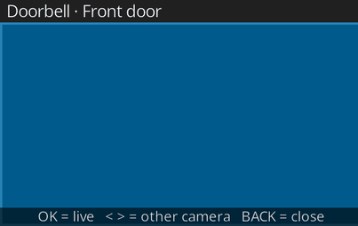
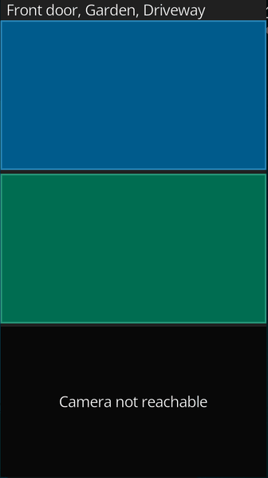
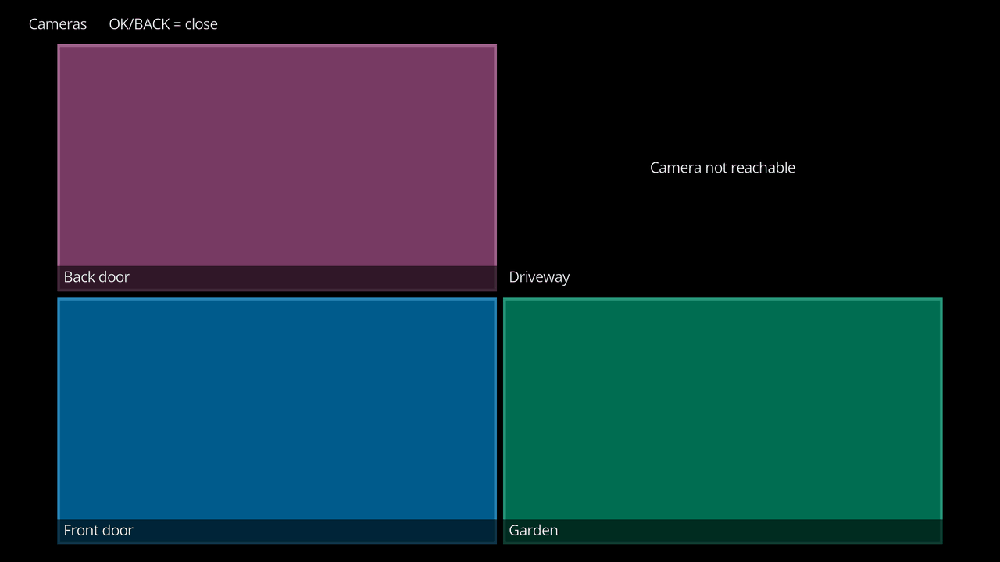
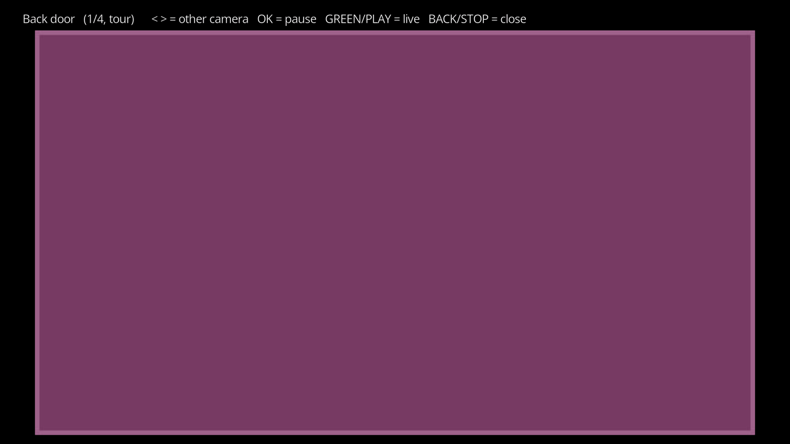
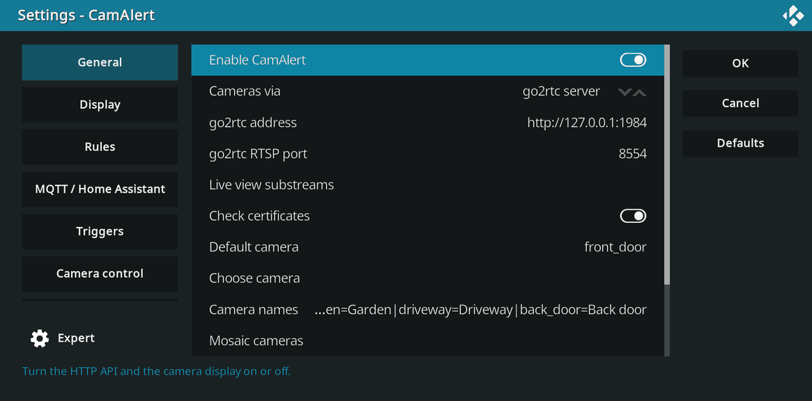
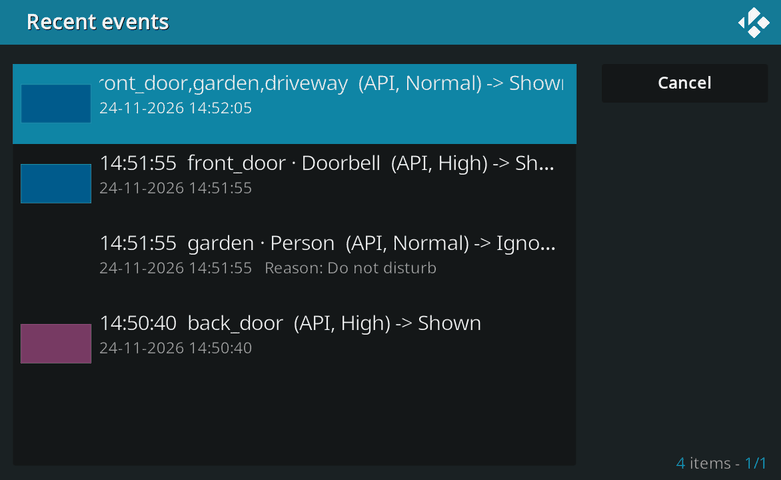
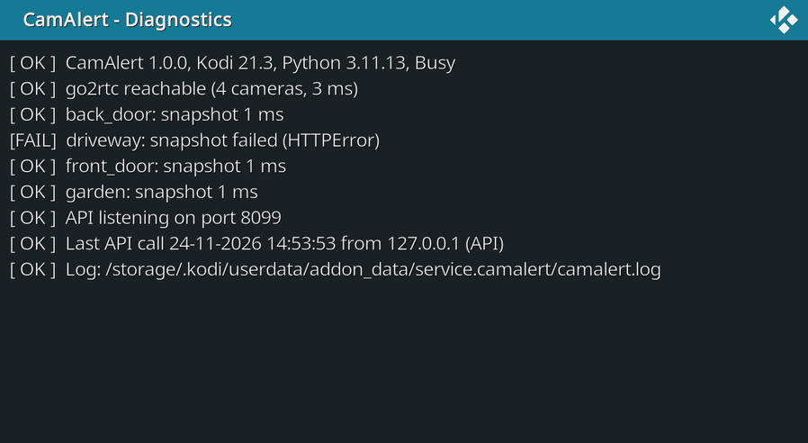

# CamAlert for Kodi

The Kodi add-on **CamAlert** (`service.camalert`) does the same as the Enigma2 plugin, on any Kodi 19 (Matrix) or newer:
LibreELEC, CoreELEC, OSMC, Windows, Linux, macOS and Android TV boxes. It uses the **same HTTP API, MQTT topics
and Home Assistant integration**, so blueprints and automations work unchanged – a Kodi is just another CamAlert
device.

## Install

**With automatic updates (recommended)**

1. Download `repository.camalert-x.y.z.zip` from the [latest release](https://github.com/kevinrossnl/camalert/releases/latest) and copy it to
   the Kodi device (USB stick, network share, or the Kodi download folder).
2. Kodi › **Settings › System › Add-ons**: turn on **Unknown sources** (needed once for a zip file).
3. Kodi › **Add-ons › Install from zip file** › choose the repository zip.
4. **Add-ons › Install from repository › CamAlert repository › Services › CamAlert › Install**.

Kodi now checks the repository and updates CamAlert by itself.

**Just the add-on:** install `service.camalert-x.y.z.zip` with *Install from zip file* (no automatic updates).

After installing, open **Add-ons › My add-ons › Services › CamAlert › Configure**.

**Watching the cameras yourself:** open CamAlert from **Add-ons › Program add-ons** (or *My add-ons › Services*). It
offers a list: *Show mosaic*, *Start tour*, *Show camera* (pick one, it opens in the photo window), *Event list*,
*Diagnostics* and *Settings*. Use Kodi's context menu › *Add to favourites* to reach it from the home screen.

## Settings

| Tab | What |
|---|---|
| General | go2rtc address, live substreams (H.265 / 4K cameras) (or *Directly from the cameras* with `cameras.conf`), default camera (**Choose camera** lists them), camera names, mosaic cameras, test buttons |
| Display | photo window / live view / notification, duration, corner and size, multi-camera window layout, rotate/mirror and refresh interval per camera, remote control in the window, pause what is playing, return to what was playing, volume during live view, live format, tour speed |
| Rules | cooldown per camera, do not disturb, only between certain times, *not while playing* (off / films and recordings / everything), wake up on alarm (screen on via HDMI-CEC) |
| MQTT / Home Assistant | broker, login, discovery, name |
| Triggers | [Frigate events](../integrations/frigate.md) (via MQTT), Foscam motion and sound alarms |
| Camera control | default camera login for PTZ / Foscam (**Change camera password (default)**), create `devices.conf` |
| API | port (8099), allowed callers, token, HTTPS |
| Log and diagnostics | log level (off / errors / normal / verbose), remote syslog, **Diagnostics** (checks go2rtc, every camera's snapshot, API, MQTT, last caller) and the **event list** (last 20 requests with snapshot; OK shows the camera again or replays the Frigate clip) |

Display also has the **title size** (small / normal / large) and the **doorbell chime** (off / doorbell and alarm / every
request; it follows Kodi's volume and mute). Every setting with its default: [settings](../user/settings.md).

The API token and the MQTT password are stored by Kodi in the add-on's own `settings.xml` in its data folder; camera
passwords only in `devices.conf` (next section). None of them is ever written to a log
([where passwords are stored](../integrations/api.md#where-passwords-and-tokens-are-stored)).

## What you see

- **Photo window** – a camera in a corner while the film or TV keeps playing. Remote: **OK** = live,
  **◀ ▶** = other camera, **MENU** (or **INFO**) = camera control (PTZ), **BACK** = close, any other key closes the
  window and does what it normally does. Volume keys keep working.
- **Multi-camera window** – a request for 2 to 4 cameras (`cam=front_door,garden`) shows them together in one
  window (below each other, next to each other or 2×2); more cameras open the mosaic.
- **Live view** – the camera full screen with a small bar: **◀ ▶** other camera, **MENU** = PTZ, **BACK** = back. When the
  time is up (or after BACK) Kodi **continues the film at the same position** or **returns to the same TV channel**.
  The volume can be lowered meanwhile.
- **Notification** – a Kodi notification with a snapshot as icon.
- **Who/what in the title** – `label=Person` (API, MQTT JSON, blueprints) or Frigate's label / recognised name
  shows as "Person · Front door".
- **Colour keys → Home Assistant** – while a camera is shown, RED / GREEN / YELLOW / BLUE fire a Home Assistant
  event (MQTT event entity `camalert/<id>/button` and the integration's webhook), for example to open the door.
  The colour key chosen under *Camera control* toggles PTZ on cameras that have it. On a keyboard: F1–F4.
- **Mosaic** (up to 9 cameras; OK or BACK closes) and **tour** (◀ ▶, OK = pause, GREEN or PLAY = live view, BACK).

| | |
|---|---|
|  | **Photo window**: title (*Doorbell · Front door*) with the key hint `OK = live   < > = other camera   BACK = close` |
|  | **Multi-camera window**: 2–4 cameras; a camera that does not answer shows *Camera not reachable* |
|  | **Mosaic**: up to 9 cameras, one tile *Camera not reachable*; OK or BACK closes |
|  | **Tour**: `< >` = other camera, OK = pause, GREEN or PLAY = live view, BACK or STOP = close |
|  | **Settings** (Add-ons › My add-ons › Services › CamAlert › Configure), in sections |
|  | **Event list** (*Log and diagnostics* › *Event list* in the settings): the last 20 requests with source, priority, result and reason, plus a small snapshot |
|  | **Diagnostics** (*Log and diagnostics* › *Diagnostics* in the settings): go2rtc, a snapshot of every camera, API port, last API call, log |

All keys: [remote keys](../user/keys.md). Kodi's skin fonts have no ◀ ▶, so the hints on screen show `< >`.

## Camera control (PTZ) and Foscam alarms

Cameras that can move or that report their own alarms are listed in `devices.conf` in the add-on data folder
(*Camera control › Create devices.conf* makes an example and shows where it is):

```
# name|type|host:port|user|password      (name = CamAlert camera name; type = onvif or foscam)
front_door|onvif|192.168.1.20:80|admin|secret
garden|foscam|192.168.1.21:88|admin|secret
```

Empty user/password = the default camera login: *Camera user (default)* from the settings and the default camera
password. That password is **not** kept in Kodi's `settings.xml` (#55): type it in *Camera password (default)* and the
add-on moves it into `devices.conf` as the line `*|default|*||<password>` (file readable for Kodi's user only, written
atomically; camera lines are never changed) and empties the field again. Passwords saved there by an older version
are moved the same way when the add-on starts. **Change camera password (default)** shows whether one is stored
(`•••• (stored)`, never the password) and changes or removes it. Enigma2 skips that line (it has no default camera
login). In the photo window or live view press **MENU** (or **INFO**):
arrows pan and tilt, **CH+ / CH−** (or PAGE UP / DOWN) zoom, **OK** = home position, **BACK** leaves PTZ mode.

## Where things are

| | LibreELEC / CoreELEC | Windows | Linux / OSMC | Android |
|---|---|---|---|---|
| Add-on data (`settings.xml`, `devices.conf`, `cameras.conf`, HTTPS certificate) | `/storage/.kodi/userdata/addon_data/service.camalert/` | `%APPDATA%\Kodi\userdata\addon_data\service.camalert\` | `~/.kodi/userdata/addon_data/service.camalert/` | `Android/data/org.xbmc.kodi/files/.kodi/userdata/addon_data/service.camalert/` |
| CamAlert log (`camalert.log` + `camalert.log.1`, 2 × 1 MB) | same folder as the add-on data | same | same | same |
| Kodi log (`kodi.log`, lines start with `[CamAlert]`) | `/storage/.kodi/temp/` | `%APPDATA%\Kodi\` | `~/.kodi/temp/` | `.../files/.kodi/temp/` |

## Differences with the Enigma2 plugin

- Kodi has no standby: *screen off* (DPMS) counts as standby. An **alarm** request with *Wake up on alarm* switches
  the TV on via HDMI-CEC.
- *Pause what is playing* pauses a film or live TV (timeshift has to be supported by your PVR add-on).
- No camera channel list: use the mosaic, the tour, or Kodi favourites.
- Live view plays go2rtc's MP4 stream by default (works with every go2rtc). HLS is the most robust but runs a few
  seconds behind; RTSP needs go2rtc's RTSP port. In *Directly from the cameras* mode Kodi plays the camera's own
  `rtsp://` address (Kodi does not know `rtspt://`).
- Rotate/mirror applies to the photo window, mosaic and tour (not to the live video).
- **Windows**: allow Kodi through the Windows firewall for the API port (8099) if Home Assistant cannot reach it;
  *Wake up on alarm* only works with a CEC adapter.

## Platforms

| | Notes |
|---|---|
| LibreELEC / CoreELEC | Tested on LibreELEC 12 (Kodi 21). HDMI-CEC works out of the box (*Wake up on alarm*, colour keys of the TV remote). |
| OSMC / Raspberry Pi | As LibreELEC. A Pi 4/5 decodes H.264 fine; for H.265 or 4K cameras set a *live substream*. |
| Android TV / Nvidia Shield / Fire TV | Install from the repository zip as usual. Android may stop Kodi in the background: CamAlert only works while Kodi is running (in front or as the app that was last open). Keep the TV box from sleeping (Developer options › Stay awake, or Fire TV: Settings › Display & Sounds › Screen saver › Never) or *Wake up on alarm* cannot work. Colour keys: most Fire TV / Android remotes have none – use MENU for PTZ. |
| Windows | Data in `%APPDATA%\Kodi\userdata\addon_data\service.camalert\`. Windows asks once to allow Kodi through the firewall (needed for the API on port 8099). |
| macOS / Linux desktop | Works the same; allow incoming connections for Kodi if the system firewall is on. |

The API listens on all network interfaces (IPv4 and the IPv4 side of dual-stack); camera and go2rtc addresses may
be IPv6 literals (`http://[fd00::10]:1984`).

## Updates

Installed from the CamAlert repository, Kodi updates CamAlert by itself (Kodi checks repositories at start and
every few hours; *Settings › System › Add-ons › Updates* decides whether it installs them automatically or only
notifies).

The CamAlert repository only holds the **latest** release. To go back to an older version, download its
`service.camalert-x.y.z.zip` from the [releases page](https://github.com/kevinrossnl/camalert/releases) and use
*Install from zip file*.

## Home Assistant and monitoring

Add the Kodi like any player: **Settings › Devices & services › Add integration › CamAlert**, enter the Kodi's host
name or IP address and port 8099 (and the token if you set one), or switch on MQTT with discovery. Everything in
[Home Assistant](../integrations/home-assistant.md) applies; metrics and the Grafana dashboard:
[monitoring](../integrations/monitoring.md).

## Troubleshooting

- *Nothing happens*: check the add-on is enabled (Add-ons › My add-ons › Services) and that
  `http://<kodi>:8099/camalert/status` answers from another computer in your network.
- *Labels look empty right after a manual update*: restart Kodi once (Kodi loads new texts at start).
- *Live picture takes long to start*: keep the camera stream warm in go2rtc, or choose the RTSP live format.
- *"camera not reachable" in the window title*: go2rtc did not deliver a snapshot twice in a row; check go2rtc
  (`/api/frame.jpeg?src=<camera>`) – the window keeps trying.
- *Diagnostics*: Add-ons › My add-ons › Services › CamAlert › Configure › Log and diagnostics.
